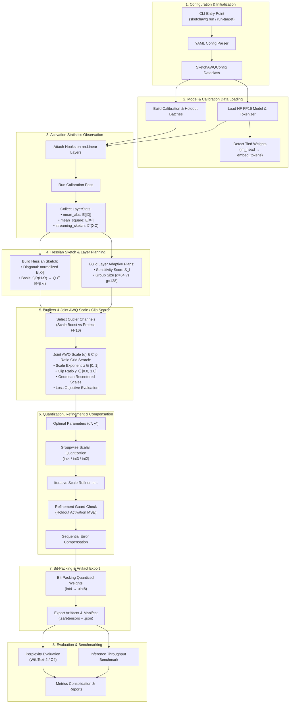

# Architecture & System Design — SketchAWQ

SketchAWQ is a flexible, highly effective model quantization framework for Large Language Models (LLMs). It combines **Activation-Aware Weight Quantization (AWQ)** equivalent input scaling with a streaming **Diagonal + Low-Rank Hessian Sketch** to score candidate scales and clip ratios, select outlier channels, dynamically adjust per-layer quantization parameters, and apply scale refinement and sequential error compensation.

This document serves as the complete architectural specification and workflow graph for SketchAWQ. It covers all 10 pipeline stages, subsystem boundaries, data flow schemas, tensor shape transformations, and mathematical formulations.

---

## 1. Top-Level System Architecture

The following Mermaid diagram details the complete execution flow from CLI invocation to packed model storage and evaluation benchmarking.



---

## 2. Layer Quantization Pipeline Flowchart

The following detailed sequence shows the exact tensor transformations and operations executed on each linear layer $l$ with weight $W \in \mathbb{R}^{O \times I}$:

```mermaid
flowchart LR
    subgraph InputState["Layer Inputs"]
        W["Weight Matrix W<br/>[O × I] FP16"]
        X["Activations X<br/>[T × I]"]
    end

    subgraph ObsStats["Observer Hooks"]
        MeanAbs["mean_abs = E[|X|]<br/>[I]"]
        MeanSq["mean_square = E[X²]<br/>[I]"]
        SketchSum["sketch_sum = Σ X_subᵀ(X_sub Ω)<br/>[I × r]"]
    end

    subgraph SketchDecomp["Sketch & Sensitivity"]
        H_diag["H_diag = mean_square / mean<br/>[I]"]
        Q_basis["Q, _ = QR(sketch_sum / N)<br/>[I × r]"]
        Sens["Sensitivity Score S_l"]
    end

    subgraph ScaleGrid["Grid Search (α, γ)"]
        RawScale["s = (mean_abs)^α / (w_col_abs)^(1-α)"]
        GeoNorm["s = s / geomean(s)"]
        FakeQuant["Fake Quantize W_scaled"]
        ScoreLoss["Loss = ||ΔW · √H_diag||² + λ||ΔW Q||²"]
    end

    subgraph FinalizeLayer["Layer Artifact Construction"]
        W_final["Quantize W with (α*, γ*)"]
        RefineGrad["Iterative Scale Refinement"]
        HoldoutCheck["Refinement Guard Check"]
        ErrorProp["Residual Error Propagation"]
        PackBits["Pack int4 → uint8"]
        Artifact["PackedLayerArtifact:<br/>• packed_weight: [O × I/2] uint8<br/>• scale: [O × I/g] FP32<br/>• zero_point: [O × I/g] FP32<br/>• input_scale: [I] FP32"]
    end

    W --> ObsStats
    X --> ObsStats
    MeanSq --> H_diag
    SketchSum --> Q_basis
    MeanAbs --> Sens
    H_diag --> ScoreLoss
    Q_basis --> ScoreLoss
    MeanAbs --> RawScale
    RawScale --> GeoNorm
    GeoNorm --> FakeQuant
    FakeQuant --> ScoreLoss
    ScoreLoss -->|Select Min Loss| BestParams["Best (α*, γ*)"]
    BestParams --> W_final
    W_final --> RefineGrad
    RefineGrad --> HoldoutCheck
    HoldoutCheck --> ErrorProp
    ErrorProp --> PackBits
    PackBits --> Artifact
```



---

## 3. Subsystem Breakdown & Data Flow

### 3.1 CLI & Experiment Layer
- **`src/sketchawq/cli.py`**: Provides the main command-line interface.
  - `sketchawq run <config.yaml>`: Executes quantization for custom YAML configs.
  - `sketchawq run-target <target_name>`: Runs named targets from `configs/experiments.yaml`.
  - `sketchawq baseline <config.yaml>`: Runs baseline comparisons (GPTQ, AWQ, RTN).
  - `sketchawq inference <config.yaml>`: Benchmarks token generation throughput and latency.
  - `sketchawq inference-summary`: Aggregates throughput metrics into HTML/CSV reports.

### 3.2 Configuration Engine
- **`src/sketchawq/config.py`**: Defines standard dataclasses for validating quantization parameters:
  - `DataConfig`: Dataset path, calibration sequence count (e.g., 128), sequence length (e.g., 512 or 2048), evaluation split.
  - `ObserverConfig`: Streaming row sample size, max calibration rows, random seed for Gaussian test matrix $\Omega$.
  - `SketchConfig`: Sketch mode (`none`, `diagonal`, `diagonal_low_rank`), rank $r$ (e.g., 16 or 32), low-rank representation (`orthonormal`, `nystrom`), spectrum factor weighting.
  - `AdaptiveConfig`: Layer sensitivity metrics, group size assignment for top fraction of sensitive layers.
  - `OutlierConfig`: Outlier selection metric (`activation`, `hessian`, `weight`, `activation_weight`, `hessian_weight`), fraction of protected channels, strategy (`scale` boost vs `protect` FP16 restoration).
  - `SearchConfig`: AWQ $\alpha$ candidate grid (e.g., `[0.0, 0.25, 0.5, 0.75, 1.0]`), clip ratio candidate grid (e.g., `[0.8, 0.85, 0.9, 0.95, 1.0]`), scale bounds `[0.25, 4.0]`, search objective (`weighted_error`, `output_error`, `hybrid`), tied weight strategy (`joint_embedding` vs `output_only`).
  - `QuantizerConfig`: Target bit-width (2–8 bits), default group size (e.g., 128, 64, 32), symmetry (`symmetric` vs `asymmetric`), scale refinement mode (`none`, `sketch`, `global_sketch`).
  - `RefinementGuardConfig`: Mode (`none`, `holdout_output`), holdout batch size, relative tolerance threshold.
  - `ErrorCompensationConfig`: Mode (`none`, `sequential_sketch`), block size for error propagation.
  - `PackingConfig`: Serialization settings, bit-packing layout.

### 3.3 Model Loading & Tied Weights
- **`src/sketchawq/models/load.py`**: Loads Hugging Face causal language models (e.g., LLaMA, Qwen) and tokenizers in FP16/BF16 precision.
- **`src/sketchawq/models/tied.py`**: Detects tied linear weights (e.g., `lm_head.weight` sharing storage with `model.embed_tokens.weight`). When joint embedding optimization is active, loss scoring incorporates gradient contributions for both layers to prevent degrading input embeddings.

### 3.4 Calibration Data Ingestion
- **`src/sketchawq/data/calibration.py`**: Formats calibration sequences from datasets such as WikiText-2, C4, or Pile. Appends padding masks so padding tokens are discarded during observer statistics accumulation.

### 3.5 Activation Observer
- **`src/sketchawq/quant/observer.py`**: Attaches PyTorch forward hooks to all target `nn.Linear` layers (e.g., `q_proj`, `k_proj`, `v_proj`, `o_proj`, `gate_proj`, `up_proj`, `down_proj`). Accumulates 3 statistics:
  1. Mean absolute activation $\mathbb{E}[|X|] \in \mathbb{R}^I$
  2. Mean squared activation $\mathbb{E}[X^2] \in \mathbb{R}^I$
  3. Streaming sketch matrix $S = \sum X_{\text{sub}}^T (X_{\text{sub}} \Omega) \in \mathbb{R}^{I \times r}$, where $\Omega \sim \mathcal{N}(0, I_r)$ is a fixed Gaussian test matrix.
  4. Collects holdout input rows for refinement guarding.

### 3.6 Hessian Sketch Construction
- **`src/sketchawq/quant/hessian_sketch.py`**: Constructs the Hessian approximation:
  - **Diagonal**: $H_{ii} = \frac{\text{clamp\_min}(\text{mean\_square}[i], \epsilon)}{\text{mean}(\text{mean\_square})}$.
  - **Low-Rank Subspace**: Computes $H\Omega = S / N$. Evaluates $Q, R = \text{QR}(H\Omega)$ to obtain orthonormal basis columns $Q \in \mathbb{R}^{I \times r}$ spanning the top-$r$ eigenvectors of $H$.

### 3.7 Adaptive Per-Layer Planning
- **`src/sketchawq/quant/adaptive.py`**: Ranks network layers by sensitivity score $S_l = \text{mean}(\text{top } 1\% \text{ channel scores})$. Assigns smaller group sizes (e.g., 64 vs 128) and higher outlier fractions to the most sensitive layers.

### 3.8 Outlier Channel Selection & Strategy
- **`src/sketchawq/quant/outliers.py`**: Ranks input channels $i \in \{1 \dots I\}$ using the configured metric:
  $$\text{Score}_i = \text{activation}_i \times \text{weight\_col\_norm}_i$$
  Selects top $k = \lceil I \times \text{outlier\_fraction} \rceil$ channels:
  - **Strategy `scale`**: Multiplies channel scale $s_i$ by scale boost factor (e.g. 2.0).
  - **Strategy `protect`**: Leaves weights in int4 during search, but restores original FP16 weights for those $k$ columns during packing.

### 3.9 Joint AWQ Scale ($\alpha$) & Clip Ratio Search
- **`src/sketchawq/quant/awq_scale_search.py`**, **`clip_search.py`**, **`loss.py`**:
  Performs grid search over scale power $\alpha$ and weight clipping ratio $\gamma$:
  $$s_i = \frac{(\text{act}_i)^\alpha}{(\text{wcol}_i)^{1-\alpha}}, \quad s_i \leftarrow \frac{s_i}{\text{geomean}(s)}$$
  Simulates fake quantization on scaled weights $W \odot s^T$, dequantizes back to original space, and computes loss:
  $$\mathcal{L}(\alpha, \gamma) = \| (W - W_{\text{deq}}) \odot \sqrt{H_{\text{diag}}} \|_F^2 + \lambda \| (W - W_{\text{deq}}) Q \|_F^2$$
  Selects $(\alpha^*, \gamma^*)$ that minimizes $\mathcal{L}$.

### 3.10 Quantization, Refinement, Guarding & Compensation
- **`src/sketchawq/quant/quantizer.py`**: Performs symmetric/asymmetric scalar uniform quantization per group.
  - Scale Refinement (`refine_quantized_scales`, `refine_quantized_scales_globally`): Iteratively updates group scales to minimize reconstruction error under the Hessian sketch.
- **`src/sketchawq/quant/refinement_guard.py`**: Passes holdout activation samples through layer using refined vs baseline scales. Reverts to baseline scales if output MSE increases on holdout data.
- **`src/sketchawq/quant/error_compensation.py`**: `sequentially_compensate_quantized_weight` propagates residual error from quantized blocks to unquantized blocks along column dimension.

### 3.11 Bit Packing & Storage Export
- **`src/sketchawq/quant/pack.py`**: Shifts signed int values to unsigned $[0 \dots 2^b-1]$. Packs multiple low-bit values (e.g. two 4-bit integers) into single `uint8` bytes.
- **`src/sketchawq/models/save.py`**: Serializes packed weight tensors and metadata into `packed_model.safetensors`, `packed_manifest.json`, and execution metrics `report.json`.

---

## 4. Key Data Structure Schemas

```python
@dataclass(frozen=True, slots=True)
class LayerStats:
    name: str
    abs_sum: torch.Tensor          # Shape: [I] (FP32)
    sq_sum: torch.Tensor           # Shape: [I] (FP32)
    count: int                     # Total tokens observed
    sketch_sum: torch.Tensor       # Shape: [I, r] (FP32)
    sketch_count: int              # Total sketch batches
    holdout_inputs: torch.Tensor   # Shape: [T_holdout, I] (FP16)

@dataclass(frozen=True, slots=True)
class HessianSketch:
    diagonal: torch.Tensor         # Shape: [I] normalized diagonal
    basis: torch.Tensor            # Shape: [I, r] orthonormal basis Q
    representation: str           # "orthonormal" or "nystrom"
    spectrum_factor: torch.Tensor  # Eigenvalue weighting factors

@dataclass(frozen=True, slots=True)
class QuantizedTensor:
    qweight: torch.Tensor          # Shape: [O, I] (int8/int32 representation)
    scale: torch.Tensor            # Shape: [O, I / group_size] (FP32)
    zero_point: torch.Tensor | None# Shape: [O, I / group_size] (FP32)

@dataclass(frozen=True, slots=True)
class PackedLayerArtifact:
    name: str
    weight_names: tuple[str, ...]
    packed_weight: torch.Tensor    # Shape: [O, I / (8/b)] (uint8)
    scale: torch.Tensor            # Shape: [O, I / group_size] (FP32)
    zero_point: torch.Tensor | None# Shape: [O, I / group_size] (FP32)
    input_scale: torch.Tensor      # Shape: [I] AWQ input scale (FP32)
    protected_indices: torch.Tensor# Shape: [k] Outlier column indices (int64)
    protected_weight: torch.Tensor | None # Shape: [O, k] Unquantized FP16 weights
    bits: int                      # Quantization bit-width
    group_size: int                # Quantization group size
    original_shape: tuple[int, ...] # Original (O, I) shape
```

---

## 5. Mathematical Formulations Reference

### 5.1 Gauss-Newton Hessian & Low-Rank Sketch
The second-order Taylor expansion of task loss $\mathcal{L}$ with respect to weight perturbation $\Delta W = W - W_{\text{deq}}$ is given by:
$$\Delta \mathcal{L} \approx \frac{1}{2} \text{Tr}\left( \Delta W \cdot H \cdot \Delta W^T \right), \quad \text{where } H = 2 \mathbb{E}\left[ X^T X \right] \in \mathbb{R}^{I \times I}$$

To compute $H$ without explicitly constructing the $I \times I$ matrix in memory:
1. **Diagonal Proxy**: $H_{ii} = \mathbb{E}[X_i^2]$.
2. **Streaming Projection**: $H \Omega = \mathbb{E}\left[ X^T (X \Omega) \right] \in \mathbb{R}^{I \times r}$, with $\Omega \sim \mathcal{N}(0, I_r)$.
3. **Orthonormal Subspace**: $Q, R = \text{QR}(H \Omega)$, where $Q \in \mathbb{R}^{I \times r}$ satisfies $Q^T Q = I_r$.

### 5.2 AWQ Scale Formulation & Recentering
For input scale vector $s \in \mathbb{R}^I$ parameterized by exponent $\alpha \in [0, 1]$:
$$s_i = \frac{(\mathbb{E}[|X_i|])^\alpha}{\left(\frac{1}{O} \sum_j |W_{j,i}|\right)^{1-\alpha}}$$
Geometric mean normalization ensures scale invariance across layers:
$$s_i \leftarrow \frac{s_i}{\exp\left( \frac{1}{I} \sum_{k=1}^I \ln s_k \right)}$$

### 5.3 Loss Objective Formulation
During joint scale and clip search, candidates are evaluated via the weighted loss objective:
$$\mathcal{L}_{\text{search}} = \frac{1}{O \cdot I} \sum_{j=1}^O \sum_{i=1}^I (W_{j,i} - W_{\text{deq}, j,i})^2 \cdot H_{ii} + \lambda \frac{1}{O \cdot r} \sum_{j=1}^O \sum_{k=1}^r \left( \sum_{i=1}^I (W_{j,i} - W_{\text{deq}, j,i}) Q_{i,k} \right)^2$$

---

## 6. Storage vs. Runtime Execution Boundary

```
┌─────────────────────────────────────────────────────────────────────────────┐
│                            SketchAWQ Pipeline                               │
│                                                                             │
│ ┌──────────────────────────────────┐      ┌───────────────────────────────┐ │
│ │    Quantization & Packaging      │      │     Storage & Export Format   │ │
│ │  • Search (α*, clip*)            │ ---> │  • packed_model.safetensors   │ │
│ │  • Scale refinement & guard      │      │  • packed_manifest.json       │ │
│ │  • Bit-packing int4 → uint8      │      │  • execution_report.json      │ │
│ └──────────────────────────────────┘      └───────────────────────────────┘ │
└─────────────────────────────────────────────────────────────────────────────┘
                                    │
                                    ▼
┌─────────────────────────────────────────────────────────────────────────────┐
│                          Evaluation / Serving Boundary                      │
│                                                                             │
│  [ Current Reference Implementation ]      [ High-Performance Inference ]    │
│  • Dequantizes uint8 → FP16 on load       • Custom CUDA / Triton kernels    │
│  • Runs dense linear PyTorch eval         • Direct GEMM on packed int4      │
│  • Verifies exact loss & PPL              • Fuses input_scale into prev layer│
└─────────────────────────────────────────────────────────────────────────────┘
```

1. **Packed Storage Format**: Artifacts output by `sketchawq.models.save` contain bit-packed weight tensors, scales, zero points, input scales, and outlier indices.
2. **Current Reference Runtime**: For accuracy and perplexity evaluation, `sketchawq` dequantizes packed weights into dense FP16 weights on model load, ensuring bit-exact model execution without needing custom CUDA compilation during experimentation.
3. **Serving Integration Boundary**: For actual hardware speedups, packed layer artifacts map directly to custom INT4 matrix multiplication CUDA/Triton kernels (`SketchAWQLinear`), where input scale $s_{in}$ is fused into the activation vector or previous layer bias vector.
