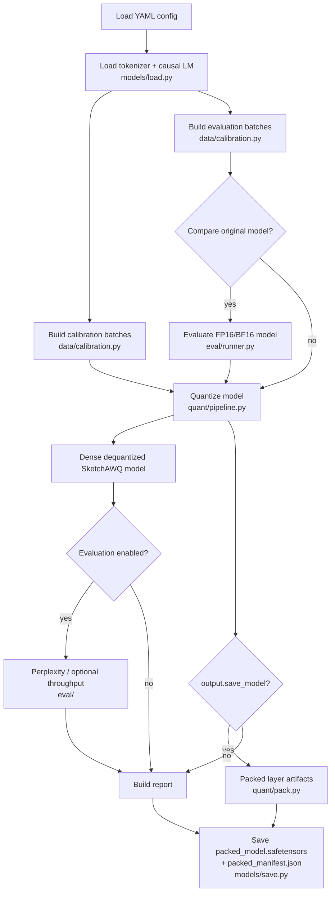

# Architecture

This document describes the **current executable SketchAWQ code path on `main`**. It is intentionally based on the implementation, not on planned features or older diagrams.

SketchAWQ is organized as a reusable Python package plus a thin experiment/CLI layer. The core post-training quantization flow is:

1. load a causal LM and tokenizer,
2. build calibration and evaluation batches,
3. collect activation statistics for each `torch.nn.Linear`,
4. build a diagonal or diagonal-plus-low-rank Hessian sketch,
5. optionally build an adaptive per-layer plan,
6. select/handle sensitive input channels,
7. search AWQ input scales and clipping ratios,
8. quantize each linear weight matrix groupwise,
9. evaluate the dense dequantized model,
10. optionally pack/export the integer weights.

There is currently **no iterative scale-refinement stage, no refinement holdout guard, and no accept/revert refinement loop**.

## End-to-End Runner

The main experiment entrypoint is `src/sketchawq/experiments/run_quantization.py`.



Calibration and evaluation data are configured independently. Evaluation may also explicitly reuse calibration batches with `evaluation.use_calibration_data=true`.

## Core Quantization Pipeline

`src/sketchawq/quant/pipeline.py::quantize_model()` is the central implementation.

```mermaid
flowchart TD
    A[Calibration forward pass] --> B[Per-linear LayerStats\nobserver.py]
    B --> C[mean |X|]
    B --> D[mean X^2]
    B --> E[H Omega approx X^T X Omega]
    B --> F[Optional sampled activation rows]

    D --> G[Hessian diagonal]
    E --> H[QR -> low-rank basis Q]
    G --> I[HessianSketch]
    H --> I

    I --> J[Optional adaptive layer plan\nadaptive.py]
    I --> K[Outlier/sensitive-channel scoring\noutliers.py]
    J --> K

    K --> L[AWQ scale + clip search\nawq_scale_search.py / clip_search.py]
    C --> L
    F --> L
    I --> L

    L --> M[Groupwise quantize W * s\nquantizer.py]
    M --> N[Dequantize and undo input scale]
    N --> O[Apply outlier policy\nrestore protected channels when configured]
    O --> P[Copy quantized dense weight into module]

    M --> Q{output.save_model?}
    Q -->|yes| R[Pack integer qweights to uint8\npack.py]
    Q -->|no| P
```

The model used for normal evaluation is the dense model after quantize/dequantize simulation. Packed weights are an export/storage representation and are not the runtime weights used by the standard evaluation path.

## 1. Model Loading

`src/sketchawq/models/load.py`

- loads the tokenizer with `AutoTokenizer.from_pretrained`,
- assigns `eos_token` as padding when a tokenizer has no pad token,
- loads `AutoModelForCausalLM`,
- supports configured `float16`, `bfloat16`, or `float32`,
- moves the model to the selected device,
- switches the model to evaluation mode.

Linear layers are discovered by `src/sketchawq/models/layers.py::iter_named_linears()`, which yields every module that is an instance of `torch.nn.Linear`.

## 2. Calibration and Evaluation Data

`src/sketchawq/data/calibration.py`

Calibration sizes are **configuration values**, not architectural constants. The code supports different datasets, sample counts, sequence lengths, batch sizes, and packing strategies.

Two data roles exist:

- **Calibration batches**: used to collect activation statistics and drive quantization search.
- **Evaluation batches**: used to evaluate the original and/or quantized model.

There is no mandatory third "refinement holdout" split in the current code.

When packing is enabled, text can be converted into fixed-length token chunks using either the streaming/EOS-buffer strategy or concatenation strategy.

## 3. Activation Observer and Streaming Hessian Inputs

`src/sketchawq/quant/observer.py`

A forward hook is attached to each linear layer. For an incoming activation with final dimension `I`, the observer flattens token/batch dimensions into rows, giving an activation matrix conceptually shaped as:

```text
X : [observed rows, I]
```

For each layer the observer accumulates:

- `abs_sum` -> mean absolute activation `E[|X|]`,
- `sq_sum` -> mean squared activation `E[X^2]`,
- `sketch_sum` -> sampled streaming estimate of `X^T (X Omega)`,
- optional sampled activation rows for output-aware candidate scoring.

`Omega` is a seeded random projection matrix with shape `[I, sketch_rank]` when low-rank sketching is enabled.

The observer also handles attention-mask filtering and configurable row sampling (`random` or `linspace`). Statistics are moved to CPU after collection.

## 4. Hessian Sketch Construction

`src/sketchawq/quant/hessian_sketch.py`

The supported sketch modes are:

- `none`,
- `diagonal`,
- `diagonal_low_rank`.

For the diagonal term, the implementation uses the observed mean-square activation, applies a floor, and normalizes it by its mean.

For the low-rank term, the observer-provided Hessian-times-random-projection estimate is orthonormalized with reduced QR:

```text
Q, _ = qr(H Omega)
```

The resulting `HessianSketch` contains:

- `diagonal`,
- optional low-rank basis `Q`,
- effective rank,
- effective sketch mode.

## 5. Optional Adaptive Layer Planning

`src/sketchawq/quant/adaptive.py`

Adaptive planning is optional and is controlled by `adaptive.enabled`.

For each layer, the planner derives a sensitivity score from configured channel-sensitivity metrics. It can then change:

- the effective group size for the most sensitive layers,
- the protected/outlier fraction for each layer.

The actual group sizes are configuration driven (`quantization.group_size` and optional `adaptive.sensitive_group_size`). They are not hard-coded to a particular pair such as 64 and 128.

When adaptive planning is disabled, all layers use the normal configured group size and base outlier fraction.

## 6. Sensitive / Outlier Channel Handling

`src/sketchawq/quant/outliers.py`

Input channels can be scored with one of:

- `activation`,
- `hessian`,
- `weight`,
- `activation_weight`,
- `hessian_weight`.

The selected top channels can be handled with two strategies:

### `scale`

Selected channels receive an additional multiplicative AWQ scale boost before candidate quantization. Scales may then be renormalized.

### `protect`

Selected columns are quantized during the normal candidate path but are restored from the original full-precision weight after dequantization. When packed export is enabled, their indices and full-precision protected weights are stored as side data.

This outlier-selection stage is part of the real pipeline and occurs before final scale/clip selection and final quantization.

## 7. AWQ Scale and Clip Search

`src/sketchawq/quant/awq_scale_search.py`  
`src/sketchawq/quant/clip_search.py`

The AWQ-style input scale for a candidate `alpha` combines activation magnitude and per-input-column weight magnitude. Scales are clamped and can be normalized by geometric mean, arithmetic mean, or left unnormalized.

The code supports two search strategies.

### Joint search

For every candidate `alpha`, evaluate every clipping-ratio candidate and keep the globally best pair.

```text
for alpha in alpha_candidates:
    for clip_ratio in clip_candidates:
        evaluate(alpha, clip_ratio)
```

### Greedy search

1. search for the best AWQ scale / `alpha`,
2. keep that scale fixed,
3. search clipping ratios.

The exact path is determined by `quantization.scale_clip_search`.

Candidate weights are produced through fake quantization and scored with one of three objectives:

- `weighted_error`,
- `output_error`,
- `hybrid`.

### Weighted sketch error

`src/sketchawq/quant/loss.py::weighted_error_score()` combines:

- diagonal-Hessian-weighted weight reconstruction error,
- optional low-rank projected error through `Q`.

Conceptually:

```text
DeltaW = W - W_q

L_diag  ~ mean(DeltaW^2 * H_diag)
L_low   ~ mean((DeltaW Q)^2)
L       = L_diag + lambda * L_low
```

The implementation can normalize these terms by the corresponding original-weight energy.

### Output-aware error

When activation rows were collected, the code can directly score layer-output reconstruction error:

```text
DeltaY = DeltaW X_sample^T
```

### Hybrid error

The hybrid objective combines the sketch-weighted error and sampled-output error with configured weights.

## 8. Groupwise Quantization

`src/sketchawq/quant/quantizer.py`

Weights are quantized along the input-channel dimension. The last dimension is padded when necessary so it can be reshaped into equal-sized groups.

Supported configured bit widths are:

- 2-bit,
- 3-bit,
- 4-bit,
- 8-bit.

Both symmetric and asymmetric quantization are implemented.

For AWQ-equivalent input scaling, the implementation:

```text
1. multiplies W by input scale s,
2. groupwise quantizes W * s,
3. dequantizes,
4. divides by s to return to the original linear-layer parameterization.
```

The integer `qweight` is held as `int16` inside `QuantizedTensor`; this is an intermediate representation, not the final packed storage format.

After dequantization and optional protected-column restoration, `pipeline.py` copies the resulting dense weight back into the original linear module. This is the model subsequently used for perplexity and ordinary throughput evaluation.

There is **no iterative post-quantization scale refinement or holdout-based rollback in this code path**.

## 9. Packing and Export

`src/sketchawq/quant/pack.py`  
`src/sketchawq/models/save.py`

When `output.save_model=true`, the pipeline creates `PackedLayerArtifact` objects.

The qweights are converted to non-negative integer codes and bit-packed into `torch.uint8`. The packing implementation supports arbitrary bit widths from 1 through 8, while the SketchAWQ quantization config currently exposes 2/3/4/8-bit modes.

The exported packed checkpoint contains:

```text
packed_model.safetensors
packed_manifest.json
```

Per quantized layer, the manifest/export records the information required to reconstruct the layer, including:

- packed weight bytes,
- group scales,
- optional zero points,
- AWQ input scales,
- bit width,
- group size,
- original shape,
- optional protected-channel indices and full-precision protected weights.

If `output.save_dense_simulation=true`, the dense quantize/dequantize simulation can also be saved as a normal Hugging Face model directory.

## 10. Evaluation

`src/sketchawq/eval/`

### Perplexity

`eval/perplexity.py` computes causal-LM cross-entropy after shifting logits/labels and reports loss and perplexity.

### Forward throughput

`eval/throughput.py` measures tokens per second over ordinary dense model forward passes when enabled.

### Generation benchmark

`eval/inference.py` and `experiments/benchmark_inference.py` provide a separate autoregressive generation benchmark with prefill/decode timing, TTFT, throughput, and peak-memory measurements.

## Current Runtime Boundary

The packed format is currently a **storage/export format**, not a packed low-bit inference runtime.

Normal SketchAWQ evaluation and the `sketchawq_dense` inference benchmark run the model after low-bit weights have been dequantized back into ordinary dense linear-layer tensors.

Therefore current throughput numbers should be interpreted as **dense dequantized simulation throughput**, not as INT2/INT3/INT4 kernel throughput.

Real packed inference speedups would require a runtime such as a `SketchAWQLinear` implementation backed by CUDA/Triton kernels or integration with an existing low-bit serving stack.

## Configurable Paths

Several features exist in the code but are not mandatory in every run:

| Feature | Control | Effect |
|---|---|---|
| Low-rank Hessian sketch | `sketch.mode`, `sketch.rank` | Adds low-rank basis `Q` to the candidate objective |
| Adaptive planning | `adaptive.enabled` | Can vary group size and outlier fraction per layer |
| Outlier handling | `outliers.enabled`, `outliers.strategy` | Scale or protect selected input channels |
| Search style | `quantization.scale_clip_search` | `joint` or `greedy` alpha/clip search |
| Search objective | `quantization.search_objective` | weighted, output-aware, or hybrid error |
| Packed export | `output.save_model` | Builds/saves packed integer artifacts |
| Dense model export | `output.save_dense_simulation` | Saves dequantized simulation as a Hugging Face model |
| Original-model comparison | `evaluation.compare_original` | Evaluates the unquantized model before PTQ |
| Throughput measurement | `evaluation.measure_throughput` | Adds forward throughput measurement |

## Features Not Present in the Current Executable Pipeline

The following should **not** be shown as implemented SketchAWQ stages unless code is added for them later:

- `refinement_guard.py`,
- iterative scale refinement after final quantization,
- a separate refinement holdout batch,
- "refined MSE < baseline" accept/revert logic,
- packed INT2/INT3/INT4 inference kernels.

## Experiment Layer

`configs/experiments.yaml` is the catalog of named experiment targets. The repository also contains canonical paper configs, baseline configs, smoke configs, paper-evaluation scripts, Modal entrypoints, reporting utilities, and focused tests.

The architecture above is intentionally configuration-aware: individual paper configs may choose different calibration sizes, group sizes, search objectives, outlier settings, or search strategies while still executing the same underlying code path.
