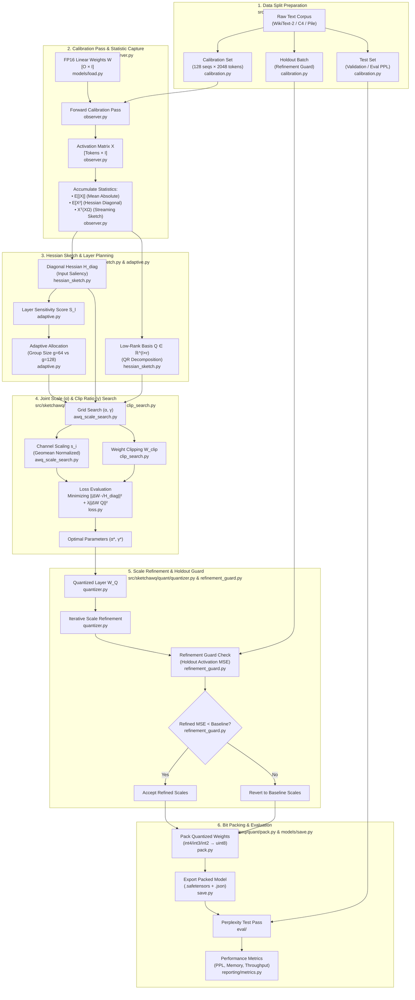
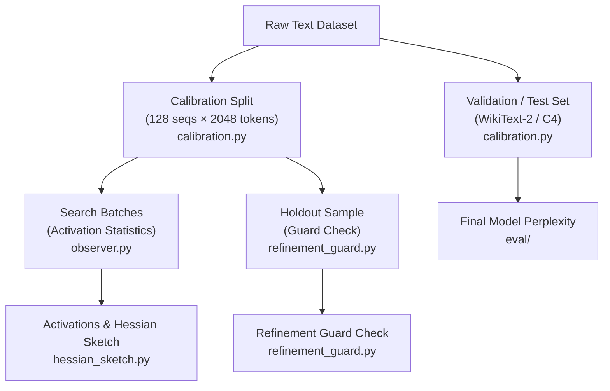
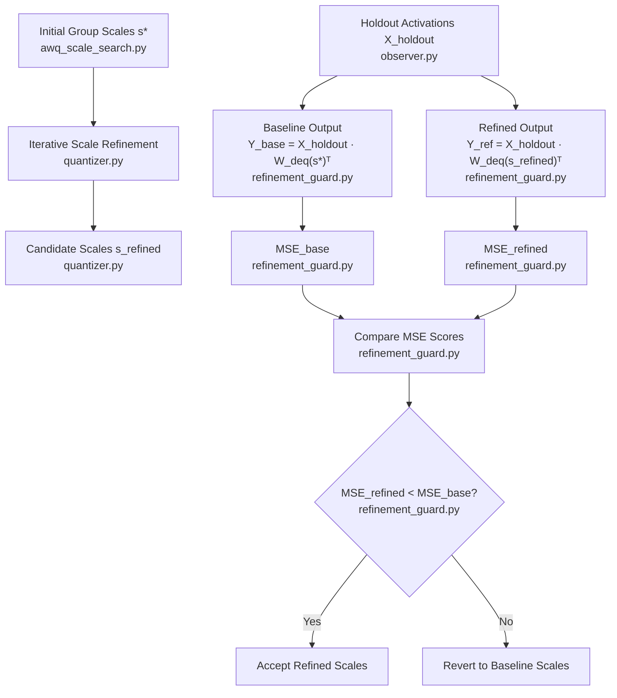

# SketchAWQ Architecture & Data Workflow Specification

This document provides a conceptual, data-centric guide to the **SketchAWQ** model quantization framework. It focuses on the **end-to-end data workflow**, **data split boundaries (Calibration vs. Test/Validation)**, **groupwise quantization mechanics**, **Alpha ($\alpha$) and Clip Ratio ($\gamma$) optimization**, **quantization refinement guarding**, and the **corresponding Python source files** for every pipeline stage.

Designed for readability and presentation quality (suitable for export to **PDF**), this document illustrates the mathematical transformations, tensor movements, system processes, and code module mappings with clean, uncluttered diagrams.

---

<div style="page-break-after: always;"></div>

## 1. High-Level Data Workflow

The quantization pipeline transforms a high-precision **FP16/BF16 Language Model** into a compressed **2-bit, 3-bit, or 4-bit Packed Model** using calibration text sequences. Each stage is mapped directly to its underlying Python implementation file in `src/sketchawq/`.



---

<div style="page-break-after: always;"></div>

## 2. Dataset Split Hierarchy: Calibration vs. Test/Validation

To ensure robust quantization without data leakage or over-fitting, data is split into three distinct functional roles:

| Split Name | Size / Samples | Source Dataset | Python File Implementation | Purpose & Role |
| :--- | :--- | :--- | :--- | :--- |
| **Calibration Set (Train/Calib)** | 128 sequences $\times$ 512/2048 tokens | Pile / WikiText-2 / C4 | `src/sketchawq/data/calibration.py` | Passed through the FP16 model to measure activation statistics ($\mathbb{E}[|X|]$, $\mathbb{E}[X^2]$, Hessian sketch $H\Omega$). |
| **Holdout Calibration Batch** | 1–2 sequence batches | Sub-split of Calibration | `src/sketchawq/data/calibration.py` | Held out during $\alpha/\gamma$ search. Used by the **Refinement Guard** to verify that scale refinement improves true output MSE. |
| **Validation / Test Set** | Full validation split (~2461 seqs) | WikiText-2 / C4 / PTB | `src/sketchawq/eval/` | Strictly reserved for final evaluation. Measures Perplexity (PPL) and zero-shot accuracy of the final packed model. |



---

<div style="page-break-after: always;"></div>

## 3. Layer Mechanics & Tensor Transformations

For any linear projection layer in an LLM (e.g. Query, Key, Value, Attention Output, SwiGLU Gate, Up-Projection, or Down-Projection), the unquantized operation processes input token activations $X$:

$$\text{Output } Y = X \cdot W^T, \quad \text{where } W \in \mathbb{R}^{O \times I}, \, X \in \mathbb{R}^{T \times I}$$

- Executed by `src/sketchawq/models/load.py` & `src/sketchawq/quant/observer.py`
- $O$ = Number of Output Channels (Out Features / Rows)
- $I$ = Number of Input Channels (In Features / Columns)
- $T$ = Total Tokens in batch ($T = \text{Batch Size} \times \text{Sequence Length}$)

```
                        Input Activations X [T × I]
                           ┌───────────────────┐
                           │ x₁₁  x₁₂  ... x₁I │
                           │ x₂₁  x₂₂  ... x₂I │
                           │  :    :        :  │
                           │ xT₁  xT₂  ... xTI │
                           └─────────┬─────────┘
                                     │
                                     ▼
Weight Matrix W [O × I]    ┌───────────────────┐    Output Activations Y [T × O]
┌───────────────────┐      │                   │    ┌───────────────────┐
│ w₁₁  w₁₂  ... w₁I │  ×   │     Matrix        │ =  │ y₁₁  y₁₂  ... y₁O │
│ w₂₁  w₂₂  ... w₂I │      │ Multiplications   │    │ y₂₁  y₂₂  ... y₂O │
│  :    :        :  │      │                   │    │  :    :        :  │
│ wO₁  wO₂  ... wOI │      └───────────────────┘    │ yT₁  yT₂  ... yTO │
└───────────────────┘                               └───────────────────┘
```

---

<div style="page-break-after: always;"></div>

## 4. Groupwise Quantization Mechanics

A single scalar scale for an entire weight row causes precision loss when weight magnitudes vary across input channels. **Groupwise Quantization** (`src/sketchawq/quant/quantizer.py`) splits the column dimension $I$ into small contiguous blocks of size $g$ (e.g. $g = 128$ or $g = 64$).

### 4.1 Weight Matrix Group Partitioning

```
                          Input Channel Dimension I (Columns)
        ◄──────────────────────────────────────────────────────────────────►
        ┌──────────────────┬──────────────────┬───┬──────────────────┐
     ▲  │     Group 1      │     Group 2      │...│     Group K      │
     │  │  (Cols 1 ... g)  │ (Cols g+1 .. 2g) │   │ (Cols I-g+1..I)  │
     │  ├──────────────────┼──────────────────┼───┼──────────────────┤
Output  │ Scale s₁₁, Zero z₁₁│ Scale s₁₂, Zero z₁₂│...│ Scale s₁K, Zero z₁K│
Rows O  ├──────────────────┼──────────────────┼───┼──────────────────┤
     │  │ Scale s₂₁, Zero z₂₁│ Scale s₂₂, Zero z₂₂│...│ Scale s₂K, Zero z₂K│
     ▼  └──────────────────┴──────────────────┴───┴──────────────────┘
```

Total groups per row $K = \frac{I}{g}$. The scale and zero-point matrices have shape $\left[O \times \frac{I}{g}\right]$.

### 4.2 Adaptive Group Size Allocation (`src/sketchawq/quant/adaptive.py`)

SketchAWQ dynamically adjusts the group size $g$ based on **Layer Sensitivity Scores**:

1. **High Sensitivity Layers** (Top 25% most sensitive layers, e.g. early FFN gate projections):
   $$\text{Group Size } g = 64 \quad \longrightarrow \quad \text{Double precision resolution for salient layers}$$
2. **Standard Layers** (Remaining 75% of network layers):
   $$\text{Group Size } g = 128 \quad \longrightarrow \quad \text{Standard compression efficiency}$$

---

<div style="page-break-after: always;"></div>

## 5. Alpha ($\alpha$) and Clip Ratio ($\gamma$) Optimization

### 5.1 AWQ Equivalent Scale Formulation ($\alpha$) (`src/sketchawq/quant/awq_scale_search.py`)

Quantization error is inversely proportional to step size. To protect sensitive input channels with large activation magnitudes, SketchAWQ applies an equivalent channel scale $s \in \mathbb{R}^I$:

$$s_i = \frac{(\text{Activation Saliency}_i)^\alpha}{(\text{Weight Column Magnitude}_i)^{1-\alpha}}, \quad \text{for } i \in \{1 \dots I\}$$

Where:
- $\text{Activation Saliency}_i = \mathbb{E}[|X_i|]$ (`observer.py`)
- $\text{Weight Column Magnitude}_i = \frac{1}{O} \sum_{j=1}^O |W_{j,i}|$ (`awq_scale_search.py`)
- $\alpha \in [0.0, 1.0]$ balances activation importance versus weight importance.

To prevent overall weight magnitude drift, $s$ is normalized by its **Geometric Mean**:

$$s_i \longleftarrow \frac{s_i}{\text{geomean}(s)}, \quad \text{where } \text{geomean}(s) = \exp\left(\frac{1}{I} \sum_{k=1}^I \ln s_k\right)$$

### 5.2 Weight Clipping Ratio ($\gamma$) (`src/sketchawq/quant/clip_search.py`)

Clipping extreme weight values reduces the dynamic range $[- \text{max}, + \text{max}]$, yielding a smaller quantization step size for the majority of weights:

$$W_{\text{scaled}} = W \cdot \text{diag}(s)$$
$$\text{Max Abs}_g = \max(|W_{\text{scaled, group } g}|) \times \gamma, \quad \text{where } \gamma \in [0.8, 1.0]$$

```
                   Unclipped Distribution                 Clipped Distribution
                  ┌──────────────────────┐               ┌──────────────────────┐
                  │    /\                │               │  | /\ |              │
                  │   /  \               │  ───► Clip    │  |/  \|              │
                  │  /    \              │   Ratio γ     │  |    |              │
                  │_/______\_ Outliers   │   (e.g. 0.9)  │ _|____|_ Clamped     │
                  └──────────────────────┘               └──────────────────────┘
                  Dynamic Range = Large                  Dynamic Range = Smaller
                  Step Size    = Coarse                  Step Size    = Fine
```

### 5.3 Joint Grid Search & Loss Objective (`src/sketchawq/quant/loss.py`)

SketchAWQ evaluates candidate pairs $(\alpha, \gamma)$ using a **Hessian-Weighted Reconstruction Loss**:

$$\mathcal{L}(\alpha, \gamma) = \underbrace{\| (W - W_{\text{deq}}) \odot \sqrt{H_{\text{diag}}} \|_F^2}_{\text{Diagonal Hessian Reconstruction Loss}} + \lambda \underbrace{\| (W - W_{\text{deq}}) Q \|_F^2}_{\text{Low-Rank Hessian Correlation Loss}}$$

Where:
- $H_{\text{diag}} = \text{Normalized}(\mathbb{E}[X^2])$ penalizes perturbations on high-activation input channels (`hessian_sketch.py`).
- $Q \in \mathbb{R}^{I \times r}$ is the orthonormal basis extracted from the streaming Hessian sketch $H\Omega$ (`hessian_sketch.py`).
- $(\alpha^*, \gamma^*)$ is selected as the pair minimizing $\mathcal{L}(\alpha, \gamma)$.

---

<div style="page-break-after: always;"></div>

## 6. Scale Refinement & Refinement Guarding

After initial quantization with optimal $(\alpha^*, \gamma^*)$, SketchAWQ applies **Iterative Scale Refinement** (`quantizer.py`) followed by a **Holdout Refinement Guard** (`refinement_guard.py`).



---

<div style="page-break-after: always;"></div>

## 7. Memory Compression & Bit-Packing

At the end of quantization, low-bit integer values are packed into standard `uint8` byte arrays (`src/sketchawq/quant/pack.py`) and saved (`src/sketchawq/models/save.py`).

### 7.1 Packing Schema (4-Bit Example)

Two 4-bit unsigned integers ($v_1, v_2 \in [0 \dots 15]$) are packed into a single 8-bit byte:

$$\text{Packed Byte} = v_1 \,|\, (v_2 \ll 4)$$

```
        v₁ (4 bits: 0000..1111)        v₂ (4 bits: 0000..1111)
        ┌─────────────────────┐        ┌─────────────────────┐
        │  b₃   b₂   b₁   b₀  │        │  b₇   b₆   b₅   b₄  │
        └──────────┬──────────┘        └──────────┬──────────┘
                   │                              │
                   └──────────────┬───────────────┘
                                  ▼
                    Single Packed uint8 Byte
        ┌───────────────────────────────────────────────────┐
        │  b₇   b₆   b₅   b₄   b₃   b₂   b₁   b₀            │
        └───────────────────────────────────────────────────┘
```

### 7.2 Memory Savings Comparison

For a standard 7-Billion parameter LLM linear layer ($O=4096, I=4096$, total parameters = $16,777,216$):

| Precision Format | Bits / Weight | Weight Storage (MB) | Auxiliary Metadata (MB) | Total Memory (MB) | Compression Ratio | Source File |
| :--- | :--- | :--- | :--- | :--- | :--- | :--- |
| **FP16 Baseline** | 16 bits | 33.55 MB | 0 MB | 33.55 MB | 1.00$\times$ | `models/load.py` |
| **4-Bit Group 128** | 4 bits | 8.39 MB | 0.26 MB (Scales + Input Scale) | 8.65 MB | **3.88$\times$** | `quant/pack.py` |
| **3-Bit Group 128** | 3 bits | 6.29 MB | 0.26 MB (Scales + Input Scale) | 6.55 MB | **5.12$\times$** | `quant/pack.py` |
| **2-Bit Group 64** | 2 bits | 4.19 MB | 0.52 MB (Scales + Input Scale) | 4.71 MB | **7.12$\times$** | `quant/pack.py` |

---

## 8. Summary Checklist for Exporting to PDF

When exporting this document to PDF (via VS Code Markdown PDF, Pandoc, or Marp):
1. **Mermaid Diagrams**: Clean `<br/>` line breaks render without literal `\n` strings.
2. **Concise Node Labels + Code Module Names**: Uncluttered, professional boxes display step headlines alongside their respective `src/sketchawq/` `.py` source file implementations.
3. **Page Breaks**: `<div style="page-break-after: always;"></div>` tags separate main sections cleanly across printed PDF pages.
